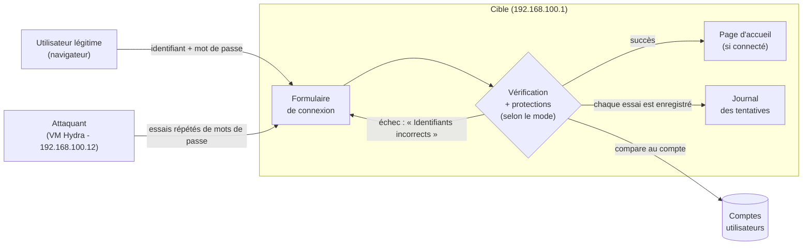
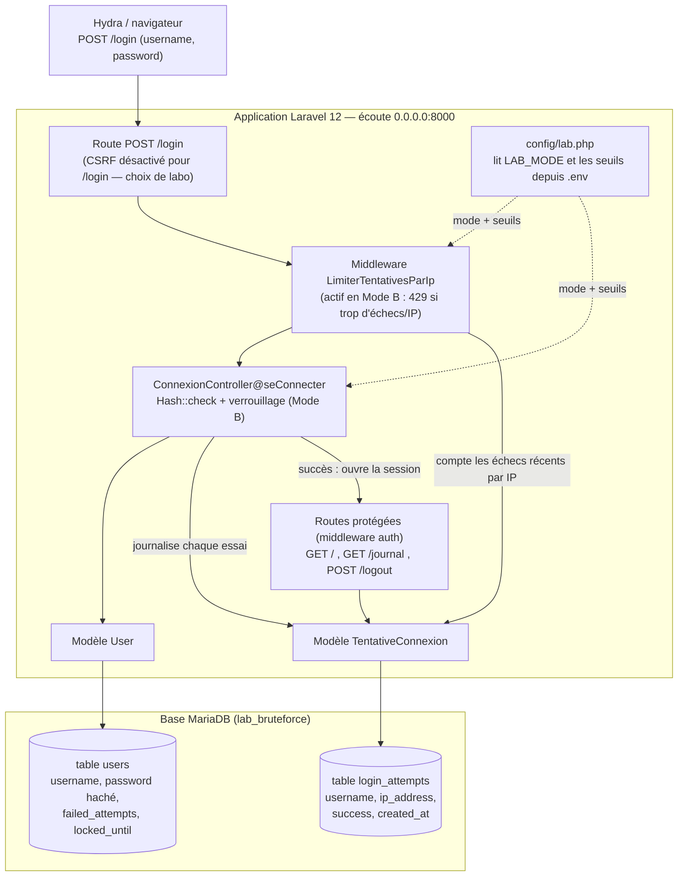

# Architecture de la cible brute force

Ce document décrit l'architecture de l'application avec deux schémas :

1. un **schéma fonctionnel**, compréhensible sans connaissance technique ;
2. un **schéma technique**, qui montre la mise en œuvre réelle dans Laravel.

> Rappel : application d'entraînement, laboratoire isolé uniquement.

---

## 1. Schéma fonctionnel (vue générale)

Ce schéma montre les grands blocs et le flux d'une tentative de connexion, sans
détail technique.

### Rôle de chaque bloc

- **Attaquant (VM Hydra)** : la machine de test qui envoie automatiquement de
  nombreux couples identifiant / mot de passe pour deviner un accès.
- **Utilisateur légitime** : une personne qui se connecte normalement depuis un
  navigateur.
- **Formulaire de connexion** : l'unique porte d'entrée de l'application.
- **Vérification + protections** : compare les identifiants fournis au compte
  et, selon le mode, applique (ou non) les protections contre le brute force.
- **Comptes utilisateurs** : les comptes enregistrés (avec mot de passe haché).
- **Journal des tentatives** : garde une trace de chaque essai ; c'est lui qui
  rend l'attaque visible, puis son blocage.
- **Page d'accueil** : accessible seulement une fois connecté.

---

## 2. Schéma technique (mise en œuvre)

Ce schéma reprend les mêmes blocs en y ajoutant les éléments techniques réels :
routes, middleware, contrôleur, modèles et tables MariaDB.

### Explication des éléments techniques

- **Route `POST /login`** (`routes/web.php`) : point d'entrée de la connexion.
  Elle est **exclue de la protection CSRF** (`bootstrap/app.php`) pour permettre
  à Hydra de poster directement. C'est un **choix délibéré de laboratoire**,
  jamais à reproduire en production ; les navigateurs envoient tout de même le
  jeton CSRF via le formulaire Blade.
- **Middleware `LimiterTentativesParIp`** : en **Mode B**, il compte les échecs
  récents de l'adresse IP (via le journal) et renvoie un **HTTP 429** au-delà du
  seuil, avant même d'atteindre le contrôleur. En **Mode A**, il laisse tout
  passer. Choisi plutôt qu'une limitation basée sur le cache car il réutilise
  directement le journal et reste simple à expliquer.
- **`ConnexionController`** : vérifie le mot de passe avec `Hash::check`,
  journalise chaque tentative, et — en Mode B — incrémente `failed_attempts` puis
  verrouille le compte (`locked_until`) après trop d'échecs.
- **`config/lab.php`** : lit le mode et les seuils depuis `.env`. Le comportement
  n'est donc jamais figé dans le code.
- **Modèle `User`** (table `users`) : identifiant `username`, mot de passe haché
  (cast `hashed`), plus `failed_attempts` et `locked_until` pour le verrouillage.
- **Modèle `TentativeConnexion`** (table `login_attempts`) : enregistre chaque
  essai et sert aussi à compter les échecs récents par IP.
- **Routes protégées** (`/`, `/journal`, `/logout`) : accessibles seulement après
  connexion grâce au middleware `auth` de Laravel (session stockée en fichier).
- **Base MariaDB** : deux tables seulement (`users`, `login_attempts`), pilote
  `pdo_mysql`. Les pilotes de session et de cache sont réglés sur « fichier »
  pour garder la base minimale.
- **Écoute `0.0.0.0:8000`** : volontaire, pour que la VM attaquante atteigne la
  cible ; acceptable car le réseau est isolé.

### Choix techniques résumés

| Choix | Raison |
|---|---|
| Laravel 12 / PHP 8.4 | Framework déjà maîtrisé, cohérent avec l'autre projet. |
| MariaDB | Déjà installée sur le poste. |
| Blade + CSS simple | Lisible, sans dépendance JS à maintenir. |
| Session et cache en fichier | Garde la base limitée à `users` + `login_attempts`. |
| Limitation via le journal | Transparente et facile à expliquer (pas de magie). |
| Mode par défaut `vulnerable` | Permet de lancer directement l'exercice d'attaque (Mode A). |
